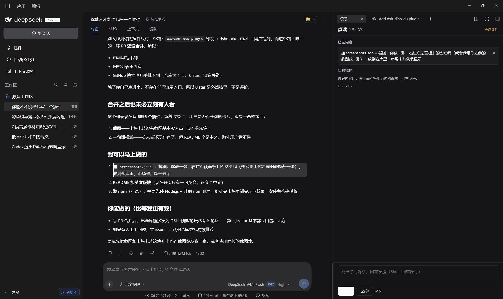

# dsh-dian-du · 点读笔 / Reading Pen

A reading-pen plugin for **DeepSeek Harness (DSH)**. Click a sentence or a single code line in an answer, ask about it, and read the explanation in a docked right-hand column — the conversation itself is never rewritten.



> 中文说明见下方 [中文](#中文).

## Features

- **Pick a passage** — click a paragraph, heading, list item or quote to select it; inside a code block, click the exact line you mean.
- **Two visual states** — blue for the current selection, amber for passages you have already asked about (a trace of "I once got stuck here").
- **Docked right column** — selecting opens the「点读」tab in DSH's right Sidebar. The conversation narrows instead of being covered.
- **Ask there** — type in the column's input, press Enter; the explanation appears in that column and the main transcript keeps its original answer.
- **Clear quickly** — tap `Ctrl` once, or `Ctrl`+click anywhere; 「查过 N 处」 clears all traces.
- **Same model as the chat** — the call follows the conversation's provider/model/reasoning effort, falling back to `high`.

## Requirements

- DSH `>= 0.2.0-rc.1` with the Web/Desktop client (the plugin registers a right-Sidebar tab and a Host command).
- A configured model provider — the explanation runs through the same LLM service as the chat.

## Install

```bash
# Desktop app profile
dsh plugin --profile desktop add github:2404376192/dsh-dian-du

# CLI / web profile
dsh plugin --profile web add github:2404376192/dsh-dian-du
```

Then **quit DSH completely and reopen it** — client bundles are scanned at startup only.

Verify: open the right Sidebar; the「点读」tab is there, and its footer shows the plugin version.

## Usage

1. Click the sentence (or the code line) you do not understand.
2. The right column opens with that passage under「已选内容」.
3. Type your question under「我的提问」and press Enter.
4. Read the explanation in the same column; the left conversation is untouched.

## How it works

| Part | Role |
|---|---|
| `client.js` | Selection, highlighting and the right-column panel; registers into `sidebar.right.pane.tab`, with a `shell.overlay` fallback |
| `index.js` | Host half: registers the `/dian-du` command and calls `ctx.llm.stream` |
| Flow | panel → `ctx.remote.session.create` (a dedicated side session) → `ctx.remote.commands.execute('/dian-du …')` → text rendered in the column |
| `cordis.patch.yml` | Bundle patch; `provider`, `model`, `reasoningEffort` can be overridden here |

Model calls happen on the Host: the browser never sees an API key, and explanations are not appended to the main conversation's log.

## Known limitations

- The main composer belongs to the main conversation. Messages sent there are answered on the left; to keep the explanation on the right, use the right column's input.
- DSH scans client bundles only at startup, so updating the plugin requires a full restart.
- Traces and selections are keyed by message node plus position; if an answer is regenerated, old traces no longer attach to it.

## Development

```bash
npm test        # node test/host.test.mjs && node test/client.test.mjs
node --check client.js && node --check index.js
```

```
client.js            browser half: selection, highlight, right-column panel
index.js             host half: /dian-du command, model call
cordis.patch.yml     bundle patch and provider/model configuration
locale/{zh,en}.json  plugin list title and description
icon.svg             plugin icon
assets/              screenshots
```

## License

MIT

---

## 中文

DeepSeek Harness（DSH）插件：在对话里**点一下** AI 回答中的某个句子或代码行，然后在**右侧独立栏**里提问，让模型专门解释这一处。左侧原始回答不改动、不新增消息。


### 功能

- **点选**：点段落 / 标题 / 列表 / 引用切换选中；代码块里点哪一行就选哪一行
- **两种颜色**：蓝色是当前选中，琥珀色是**问过的痕迹**（这里曾经不会）
- **右侧栏**：选中后自动展开「点读」标签，左侧对话被挤窄，不遮挡
- **提问**：右栏底部输入诉求，回车发送，解释出现在右栏，左侧保持原样
- **清空**：轻按一下 `Ctrl`，或 `Ctrl` + 点击任意位置；「查过 N 处」可清空全部痕迹
- **跟随当前模型**：provider / model / reasoning effort 跟随对话，兜底 `high`

### 安装

```bash
# 桌面端
dsh plugin --profile desktop add github:2404376192/dsh-dian-du

# 命令行 / web
dsh plugin --profile web add github:2404376192/dsh-dian-du
```

装完**完全退出 DSH 再打开**（客户端 bundle 只在启动时扫描）。

### 使用

1. 点一下想弄懂的句子（或代码块里的一行）
2. 右栏「点读」自动展开，选中的内容显示在「已选内容」
3. 在「我的提问」输入框里说诉求，回车
4. 解释出现在右栏，左侧对话不动

### 原理

| 部分 | 说明 |
|---|---|
| `client.js` | 点选、高亮、右栏面板；注册到 `sidebar.right.pane.tab`，另有 `shell.overlay` 兜底 |
| `index.js` | Host 半边：注册 `/dian-du` 命令，用 `ctx.llm.stream` 调模型 |
| 调用链 | 面板 → `ctx.remote.session.create`（独立「点读」会话）→ `ctx.remote.commands.execute('/dian-du …')` → 文本回显在右栏 |
| `cordis.patch.yml` | bundle 补丁；`provider` / `model` / `reasoningEffort` 可在这里改 |

模型调用只走 Host，浏览器端不接触 API key，解释也不会写进主对话的会话日志。

### 已知限制

- 主输入框属于主对话，发出去的内容由左侧回答；要解释只在右边，请用右栏底部的输入框
- DSH 只在启动时扫描客户端 bundle，更新插件必须完全退出再打开
- 痕迹和选中按「消息节点 + 位置」记录，回答被重新生成后旧痕迹挂不上

### 开发

```bash
npm test
node --check client.js && node --check index.js
```

### 许可

MIT
